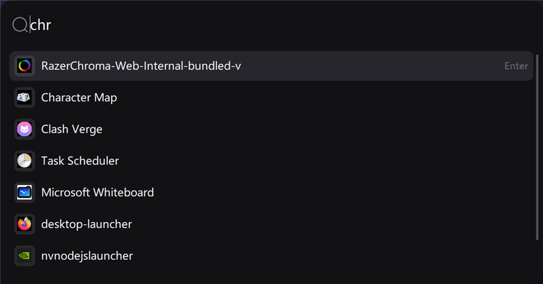
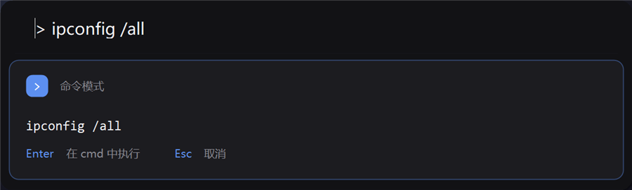
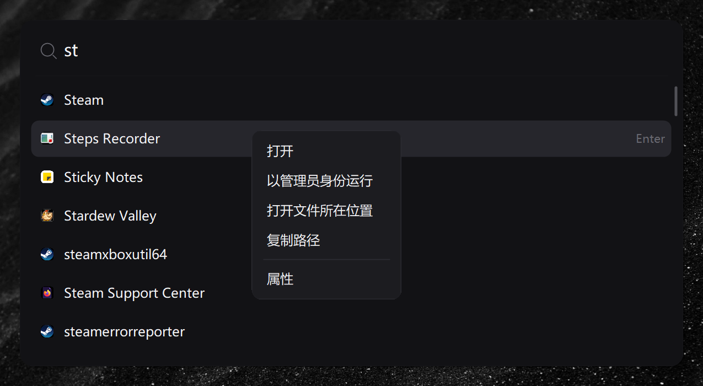

# QuickStart

一个只用来看「有什么软件、按一下就打开」的 Windows 启动器。**Alt + 空格** 呼出，打字，回车打开。

没有插件体系、没有脚本引擎、没有账号体系。整个程序是一个 **76 KB 的单文件 exe**，不依赖任何第三方库。

> **English**: QuickStart is a 76 KB single-file Windows app launcher (Alt+Space to show, type, Enter to launch).
> It is a lightweight alternative to Flow Launcher / PowerToys Run — no runtime to install, no background service, no plugins.



### 和常见启动器比

| | QuickStart | Flow Launcher | PowerToys Run |
| --- | --- | --- | --- |
| 单文件体积 | **76 KB** | ~40 MB | ~200 MB（整套 PowerToys）|
| 常驻内存 | ~45 MB（含图标缓存） | 100–200 MB | 150 MB+ |
| 需要装运行时 | 不需要（用系统自带 .NET 4.8） | 需要 .NET | 需要 .NET |
| 插件 / 脚本体系 | 无 | 有 | 有 |
| 命令模式 | 支持（`>` 开头） | 需要插件 | 部分支持 |

适合：只想要「按一下、打字、打开」的人；不想为一个启动器再装一套运行时的人。
不适合：需要计算器公式、剪贴板历史、插件市场、文件全文搜索的人。

## 功能

### 1. 搜应用

收录范围：

- 开始菜单（所有用户 + 当前用户）的 `.lnk` / `.appref-ms`
- `shell:AppsFolder` 里的商店应用（计算器、相机、日历等）
- `C:\Program Files`、`C:\Program Files (x86)`、`%LOCALAPPDATA%\Programs` 里的 exe

输入即过滤，支持子串、词首、子序列匹配（`cal` → Calculator，`cg` → Character Map）。
自动排除卸载程序、帮助文档、官网快捷方式、安装器/更新器/服务程序；同名条目只留最权威的一条。

### 2. 命令模式

输入框里以 `>` 开头，后面所有内容原样交给 cmd 执行：

```
> ipconfig
> ping baidu.com -t
> echo hello > D:\test.txt & exit
```

回车后打开一个真实的 cmd 窗口执行（用 `/k`，窗口保留方便看输出；命令里加 `& exit` 可让窗口执行完自动关闭）。
命令模式会把窗口收缩成一条命令栏。



### 3. 自定义样式的右键菜单

在结果上点右键，弹出的是自绘的暗色菜单，但每一项调用的都是**和资源管理器右键完全相同**的 shell 动作：

| 菜单项 | 实际行为 |
| --- | --- |
| 打开 | ShellExecute `open` |
| 以管理员身份运行 | ShellExecute `runas`（弹 UAC，仅 exe 显示） |
| 打开文件所在位置 | `explorer /select,<exe>`（会把 .lnk 解析到真实目标） |
| 复制路径 | 剪贴板 |
| 属性 | `ShellExecuteEx` + `properties`（系统原生属性框） |

商店应用（UWP）没有实体 exe，只显示「打开 / 复制应用 ID」。



## 键盘

| 按键 | 作用 |
| --- | --- |
| `Alt+Space` | 呼出 / 收起 |
| `>` 开头 | 进入命令模式 |
| `↑` `↓` / `PageUp` `PageDown` | 选择 |
| `Enter` | 打开选中项 / 执行命令 |
| `Esc` | 收起 |
| 鼠标左键 / 滚轮 | 打开 / 翻页 |
| 鼠标右键 | 操作菜单 |

点窗口外面会自动收起。

## 构建

不需要装 SDK：直接用 Windows 自带的 .NET Framework 4.8 编译器。

```powershell
powershell -ExecutionPolicy Bypass -File build\build.ps1
```

产物在 `dist\QuickStart.exe`。

安装到 `%LOCALAPPDATA%\QuickStart` 并注册开机自启：

```powershell
powershell -ExecutionPolicy Bypass -File build\install.ps1
```

## 开机自启与自愈

| 机制 | 说明 |
| --- | --- |
| HKCU `Run` 项 | 登录后立即启动，不需要管理员权限 |
| 计划任务 `QuickStart` | 每 5 分钟检查一次，进程不在就拉起 |

计划任务本身不常驻内存：每次只是启动一个 `--ensure` 进程，发现已在运行就在 ~30 ms 内静默退出，
不弹窗口、不抢焦点。

```powershell
QuickStart.exe --task     # 创建 / 重建自愈任务
QuickStart.exe --untask   # 删除自愈任务
QuickStart.exe --status   # 查看状态
QuickStart.exe --quit     # 退出
```

## 配置

`%LOCALAPPDATA%\QuickStart\config.ini`（改完重启程序生效）

```ini
Hotkey=Alt+Space      ; 也支持 Ctrl+Alt+Space / Ctrl+Shift+K / Win+Space / Alt+`
Theme=dark            ; dark | light
WidthRatio=0.47       ; 窗口宽度占屏幕工作区比例
MatchPath=true        ; 搜索时是否把安装路径也算关键字
ScanProgramFiles=true ; 是否扫描 Program Files 里的 exe
IconWell=true         ; 图标是否加一层极淡的圆角底片
```

## 设计取舍

- **索引只在内存里**：启动后后台扫一遍（约 0.6~1.2 秒），之后查询是对几百个短字符串做 `IndexOf`，
  单次 < 2 ms。不落盘、不常驻服务。
- **图标预热**：索引建完后在后台线程把所有图标取进内存并按目标尺寸预缩放。早期版本在
  `OnPaint` 里同步调 shell COM 取图标，每次结果变化要卡十几毫秒；现在绘制是 1:1 贴图，单帧 < 3 ms。
- **不引 WPF / WinUI**：全自绘 GDI+，常驻内存约 40–50 MB（含整份图标缓存）。
- **手动挡的视觉**：配色和排版参考 [Raycast 的设计规范](https://www.memoire.cv/references/raycast/design.md)——
  近黑底 + 卡片层、选中行用中性灰而非彩色、强调色只留给可执行动作、快捷键当一等元数据。

## 常见问题

**有比 Flow Launcher 更轻量的 Windows 启动器吗？**
有。QuickStart 是单文件 76 KB 的启动器，只做「搜应用并打开」这一件事，不装运行时、不驻留服务，
常驻内存约 45 MB，而 Flow Launcher 的安装体积约 40 MB、常驻内存 100 MB 以上。

**它是一个 exe 还是要装东西？**
一个 exe。用 Windows 自带的 .NET Framework 4.8 编译，不需要另外安装 .NET SDK 或运行时，
也不需要管理员权限（默认装到 `%LOCALAPPDATA%`）。

**能取代 PowerToys Run 吗？**
如果你只用 PowerToys Run 来搜应用，可以。它没有插件体系、没有计算器、没有文件搜索，
换来的是极小的体积和更低的常驻开销。

**支持中文软件名搜索吗？**
支持。开始菜单里的中文名（以及商店应用）都能按子串、词首、子序列匹配，
例如输入 `wx` 不会匹配「微信」，但输入「微」或「信」会。

**能在里面直接跑命令吗？**
可以。输入框里以 `>` 开头，后面所有内容原样交给 cmd 执行，例如 `> ipconfig`、`> ping baidu.com -t`。

**安全吗？会联网吗？**
不联网。程序只是读取本机的开始菜单快捷方式和 `Program Files` 里的 exe，
没有网络代码、没有遥测、没有自动更新。源码全部公开，MIT 协议。

**为什么这么小？**
因为它没有框架。全自绘 GDI+（不引 WPF/WinUI），没有第三方依赖，
索引只存在内存里，图标在后台预缩放缓存。

## 环境

- Windows 10 / 11（用到 DWM 圆角、Per-Monitor V2 DPI，Win11 效果最佳）
- .NET Framework 4.8（Windows 10 1903 之后系统自带）

## License

MIT
